# alter-timeline-portfolio

> Portfolio / CV interactivo: una vida contada como una **línea temporal 3D ramificada**.
> Autor: **Pablo Fernández Alonso** ([@pfalonso](https://github.com/pfalonso)) · Repositorio: [github.com/pfalonso/alter-timeline-portfolio](https://github.com/pfalonso/alter-timeline-portfolio)

Este README es la wiki completa del proyecto: cómo arrancarlo, cómo meter tus datos, cómo se usa, cómo está construido y cómo extenderlo.

## Índice

1. [Qué es](#1-qué-es)
2. [Inicio rápido](#2-inicio-rápido)
3. [Cómo meter tus datos](#3-cómo-meter-tus-datos)
4. [Guía de uso visual](#4-guía-de-uso-visual)
5. [Arquitectura](#5-arquitectura)
6. [Cómo extender](#6-cómo-extender)
7. [Calidad](#7-calidad)
8. [Seguridad y privacidad](#8-seguridad-y-privacidad)
9. [Accesibilidad y rendimiento](#9-accesibilidad-y-rendimiento)
10. [Limitaciones conocidas y hoja de ruta](#10-limitaciones-conocidas-y-hoja-de-ruta)
11. [Licencia](#11-licencia)

---

## 1. Qué es

Una web estática que lee un fichero JSON con los eventos de una vida (estudios, trabajos, proyectos, desvíos) y los dibuja como una línea temporal en 3D: el eje horizontal es el tiempo, cada evento es un nodo luminoso y cada bifurcación vital abre una **rama** que se separa del tronco. Los eventos se filtran por categorías definidas en los propios datos, y cada nodo abre un panel con todo el detalle.

Está hecha con Vite, TypeScript estricto y three.js, sin framework de interfaz, con arquitectura hexagonal y servida por nginx dentro de Docker. Tus datos personales nunca entran en el repositorio ni en la imagen: se montan como volumen.

| Escena | Detalle de un evento |
| --- | --- |
| 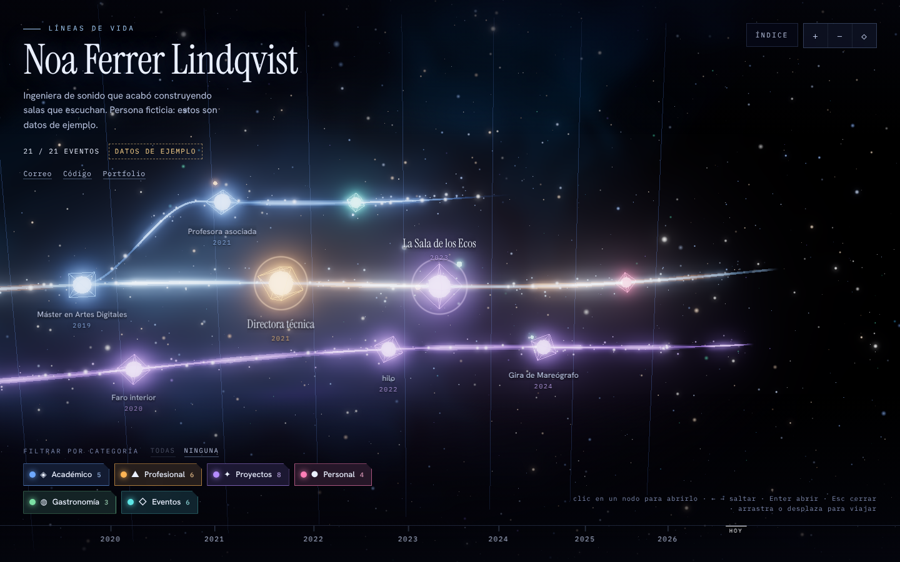 | 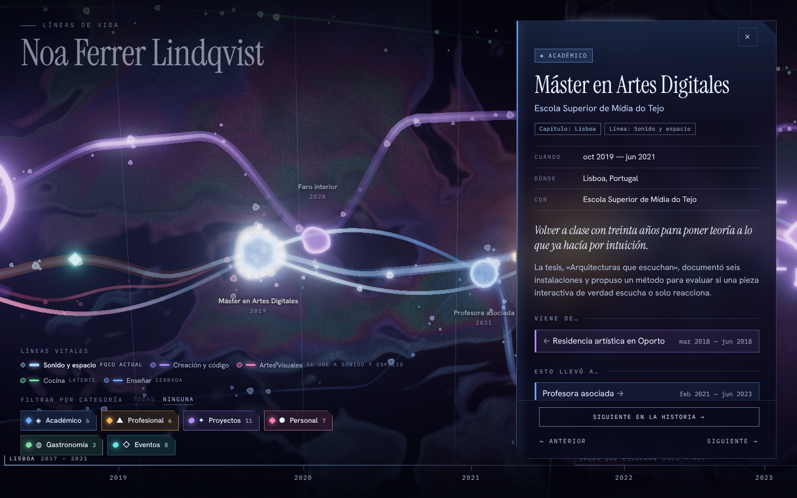 |

| Filtro por categoría | Móvil |
| --- | --- |
| 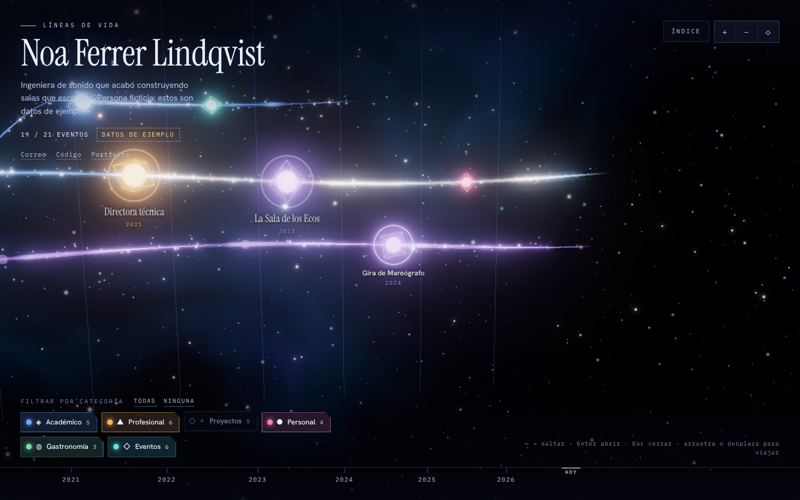 | 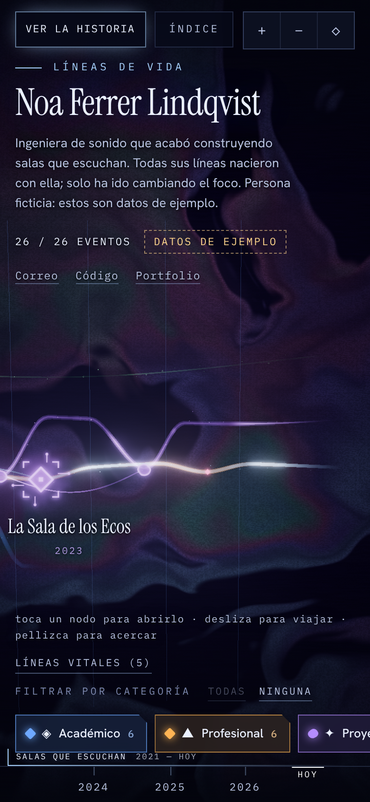 |

Las capturas usan los datos de ejemplo del repositorio (`public/data/life.example.json`), que describen a una persona ficticia.

---

## 2. Inicio rápido

### Requisitos

| Para | Necesitas |
| --- | --- |
| Docker | Docker con Compose v2 (`docker compose`) |
| Local | Node.js 20 o superior (`engines` de `package.json`; la imagen se construye con Node 22) y npm |
| Ver la escena 3D | Un navegador con WebGL2. Sin él, la web muestra la línea temporal como lista |

### Con Docker

```bash
git clone https://github.com/pfalonso/alter-timeline-portfolio.git
cd alter-timeline-portfolio
docker compose up --build
```

Abre <http://localhost:8080>. Sin `data/life.json` verás los datos de ejemplo con el aviso «Datos de ejemplo». Para parar: `docker compose down`.

> [!NOTE]
> Según `docs/DEV_NOTES.md`, `docker build` no se pudo ejecutar en el entorno donde se desarrolló el proyecto (sin acceso a los registros de imágenes). La configuración de nginx sí se probó con un nginx local que reproducía las rutas del contenedor. Mira el estado actual en [`docs/QA_REPORT.md`](docs/QA_REPORT.md).

### En local

```bash
npm install
npm run dev        # servidor de desarrollo de Vite (por defecto http://localhost:5173)
```

Para probar el resultado de producción:

```bash
npm run build      # tsc --noEmit + vite build → dist/
npm run preview    # sirve dist/ en http://localhost:4173
```

Tanto `dev` como `preview` sirven `./data/life.json` en `/data/life.json` si el fichero existe (plugin `build/personalDataPlugin.ts`).

---

## 3. Cómo meter tus datos

### 3.1 Dónde va el fichero

Tus datos van en **`data/life.json`**, en la raíz del proyecto. Lo más cómodo es partir del ejemplo:

```bash
cp public/data/life.example.json data/life.json
# edita data/life.json
npm run validate:data
```

| Fichero | Contenido | ¿En git? | ¿En la imagen Docker? |
| --- | --- | --- | --- |
| `public/data/life.example.json` | Datos ficticios de demostración | Sí | Sí |
| `data/life.json` | Tus datos reales | **No** (`/data/*` en `.gitignore`) | **No** (`data/` en `.dockerignore`) |
| `schema/life.schema.json` | JSON Schema (draft 2020-12) de la forma del documento | Sí | No hace falta |

`.gitignore` ignora todo `data/` salvo `data/.gitkeep`, y también `public/data/life.json` por si alguien lo copia ahí por error.

### 3.2 Cómo llegan los datos a la web

El navegador siempre pide `GET /data/life.json`. Quién responde depende del entorno:

| Entorno | Quién sirve `/data/life.json` | Si el fichero no existe |
| --- | --- | --- |
| `npm run dev` / `npm run preview` | El plugin de Vite, leyendo `./data/life.json` | 404 |
| Docker | nginx, leyendo el volumen `./data` montado en `/usr/share/nginx/userdata` (solo lectura) | 404 |

`docker-compose.yml` monta el **directorio** `./data`, no el fichero suelto. Así el contenedor arranca aunque `life.json` todavía no exista. Como nginx lee el fichero en cada petición y lo sirve sin caché, basta con editar `data/life.json` y recargar la página: no hay que reconstruir la imagen.

### 3.3 Fallback a los datos de ejemplo

`HttpJsonTimelineRepository` cae a `/data/life.example.json` cuando el JSON personal:

- no existe o responde con cualquier estado HTTP que no sea 2xx,
- no se puede descargar o no es JSON,
- **no pasa la validación** (en ese caso la lista de errores sale por `console.warn`).

Cuando se usan los datos de ejemplo, la cabecera muestra la etiqueta «Datos de ejemplo». Si tampoco se puede cargar el ejemplo, la web muestra un mensaje de error en la cabecera.

> [!TIP]
> Si ves «Datos de ejemplo» teniendo un `data/life.json`, casi seguro que no valida. Ejecuta `npm run validate:data` o abre la consola del navegador.

### 3.4 Validar: `npm run validate:data`

```bash
npm run validate:data                 # data/life.json si existe; si no, el de ejemplo
npm run validate:data -- otra/ruta.json
```

Usa el **mismo validador de dominio** que la web (`LifeDataValidator`), así que lo que pasa aquí carga en el navegador. Acumula todos los errores con su ruta, no solo el primero:

```text
✖ data/life.json: 2 error(es)
  - events[3].date.start: "2019-13" no es una fecha válida (YYYY, YYYY-MM o YYYY-MM-DD)
  - events[7].categories[0]: la categoría "trabajo" no existe
```

| Código de salida | Significado |
| --- | --- |
| 0 | Válido. Imprime nº de eventos, privados, categorías y ramas |
| 1 | Hay errores de validación |
| 2 | No se pudo leer el fichero o no es JSON |

### 3.5 Referencia del esquema

Raíz del documento:

| Campo | Tipo | Obligatorio | Descripción |
| --- | --- | --- | --- |
| `schemaVersion` | `1` | Sí | Versión del esquema. Solo se admite `1` |
| `meta` | objeto | Sí | Datos de cabecera del sitio |
| `categories` | lista | Sí | Al menos una categoría |
| `events` | lista | Sí | Eventos de la línea temporal (puede estar vacía) |
| `$schema` | texto | No | Referencia al JSON Schema para el autocompletado del editor |

#### `meta`

| Campo | Tipo | Obligatorio | Descripción |
| --- | --- | --- | --- |
| `owner` | texto no vacío | Sí | Nombre que aparece como título principal y en el título de la pestaña |
| `title` | texto no vacío | Sí | Titular del sitio (línea pequeña sobre el nombre) |
| `locale` | texto no vacío | Sí | Idioma BCP 47 (`"es"`, `"en"`…). Se usa para formatear fechas y para el atributo `lang` de la página |
| `tagline` | texto | No | Frase bajo el nombre |
| `contact` | lista de `{ label, url }` | No | Enlaces de contacto en la cabecera. `url` debe ser http(s) absoluta |

#### `categories[]`

| Campo | Tipo | Obligatorio | Descripción |
| --- | --- | --- | --- |
| `id` | texto kebab-case | Sí | Identificador único (`a-z`, `0-9` y guiones) |
| `label` | texto no vacío | Sí | Nombre visible en el chip de filtro y en el pop-up |
| `color` | texto `#RRGGBB` | Sí | Color del chip, de los nodos y de las ramas de esa categoría |
| `icon` | texto | No | Emoji o carácter que acompaña a la etiqueta |
| `description` | texto | No | Aparece como `title` del chip al pasar el ratón |

#### `events[]`

| Campo | Tipo | Obligatorio | Descripción |
| --- | --- | --- | --- |
| `id` | texto kebab-case | Sí | Identificador único del evento |
| `title` | texto no vacío | Sí | Título (tooltip, pop-up, índice y, si no hay `shortTitle`, rótulo del nodo) |
| `shortTitle` | texto no vacío, máx. 40 caracteres | No | Versión corta del título para el rótulo del nodo en la escena. Útil para títulos largos, que el rótulo cortaría con «…». El tooltip, el pop-up y el índice siguen mostrando `title` |
| `date` | `{ start, end? }` | Sí | Ver «Fechas» más abajo |
| `categories` | lista de ids | Sí | Al menos una. **La primera es la principal** y da color al nodo; las siguientes (hasta tres) añaden acentos de color |
| `summary` | texto no vacío | Sí | Una o dos frases: cabecera del pop-up, índice y anuncio para lectores de pantalla |
| `subtitle` | texto | No | Por ejemplo, puesto · empresa |
| `description` | texto | No | Texto largo. Los párrafos se separan con una línea en blanco (`\n\n`). Se pinta como texto, nunca como HTML |
| `location` | texto | No | Fila «Dónde» del pop-up |
| `organization` | texto | No | Fila «Con» del pop-up |
| `skills` | lista de textos no vacíos | No | Sección «Habilidades» |
| `highlights` | lista de textos no vacíos | No | Sección «Hitos» |
| `links` | lista de `{ label, url }` | No | Sección «Enlaces». Solo http(s) |
| `media` | lista de `{ type: "image", url, alt }` | No | Imágenes del pop-up. `url` http(s); `alt` obligatorio (puede ser vacío) |
| `importance` | `1`, `2` o `3` | No (por defecto `2`) | Tamaño y brillo del nodo, y a qué distancia de cámara se sigue rotulando |
| `branch` | texto kebab-case | No (por defecto `"main"`) | Rama a la que pertenece el evento |
| `branchFrom` | id de evento | No | Evento **de otra rama** del que nace esta rama |
| `visibility` | `"public"` o `"private"` | No (por defecto `"public"`) | Los privados se ocultan salvo con `?private=1` |

**Fechas.** `date.start` y `date.end` admiten tres precisiones: `"YYYY"`, `"YYYY-MM"` o `"YYYY-MM-DD"`. `date.end` admite además `"present"` (evento en curso: su tramo llega hasta hoy y el pop-up muestra «En curso»). Un evento sin `end` es puntual.

Las propiedades desconocidas se ignoran: ni el validador ni el JSON Schema las rechazan.

### 3.6 Reglas de validación

Todas estas las comprueba `LifeDataValidator` (y por tanto `npm run validate:data` y la carga en el navegador):

| Regla | Detalle |
| --- | --- |
| Estructura | El documento es un objeto; `schemaVersion` es `1`; `meta` es un objeto; `categories` es una lista no vacía; `events` es una lista |
| Textos obligatorios | No pueden estar vacíos ni ser solo espacios |
| Ids | En kebab-case y únicos (categorías entre sí, eventos entre sí) |
| Color | `#RRGGBB` exacto (seis dígitos hexadecimales) |
| Categorías del evento | Lista no vacía; cada id debe existir en `categories` |
| Fechas | Formato válido, año ≥ 1000, mes 1–12, día real del mes (no existe el 30 de febrero) |
| `end` ≥ `start` | Se tiene en cuenta la precisión: `start: "2019-03"`, `end: "2019"` es válido porque 2019 contiene marzo |
| URLs | `links[].url`, `media[].url` y `meta.contact[].url` deben ser http(s) absolutas |
| `media` | `type` solo puede ser `"image"`; `alt` debe ser un texto |
| `shortTitle` | Opcional; si está, texto no vacío de 40 caracteres como máximo |
| `importance`, `visibility` | Solo los valores permitidos |
| `branch` | Id en kebab-case |
| `branchFrom` | El evento existe; no es el propio evento; no pertenece a la misma rama |
| Tronco | Un evento de la rama `main` no puede llevar `branchFrom` |
| Un origen por rama | Todos los `branchFrom` de una misma rama deben apuntar al mismo evento |
| Sin ciclos | Las ramas no pueden bifurcarse unas de otras en círculo |

> [!NOTE]
> `schema/life.schema.json` describe la **forma** del documento y sirve para el autocompletado del editor. Las reglas cruzadas (unicidad, referencias, `end ≥ start`, ciclos, días reales del mes) no son expresables en JSON Schema: la referencia es `npm run validate:data`. El proyecto no incluye ninguna librería que valide contra el schema.

### 3.7 Ramas y bifurcaciones

- Todo evento sin `branch` pertenece al tronco, `main`.
- Para abrir una rama, pon el mismo `branch` a todos sus eventos y añade `branchFrom` **en al menos uno** de ellos (lo habitual es el primero) con el id del evento donde la vida se bifurca.
- El origen puede estar en el tronco o en otra rama (ramas que nacen de ramas).
- Una rama con algún evento en curso (`"end": "present"`) se prolonga hasta hoy. Una rama cerrada se desvanece poco después de su último evento.
- Una rama sin `branchFrom` es válida: se despega del tronco poco antes de su primer evento.
- La rama toma el color de la categoría principal de su primer evento. El tronco es siempre pálido.
- Los carriles se reparten solos (arriba, abajo, más arriba, más abajo…) y se reutilizan cuando una rama anterior ya ha terminado.

Mini ejemplo: un tronco con dos eventos y una rama `obrador` que nace del intercambio.

```json
{
  "schemaVersion": 1,
  "meta": { "owner": "Noa Ferrer", "title": "Líneas de vida", "locale": "es" },
  "categories": [
    { "id": "academico", "label": "Académico", "color": "#6EA8FF" },
    { "id": "gastronomia", "label": "Gastronomía", "color": "#7BE0A4" }
  ],
  "events": [
    {
      "id": "grado",
      "title": "Grado en Ingeniería de Sonido",
      "date": { "start": "2010-09", "end": "2014-06" },
      "categories": ["academico"],
      "summary": "Cuatro años de acústica y procesado de señal.",
      "importance": 3
    },
    {
      "id": "intercambio",
      "title": "Un semestre fuera",
      "date": { "start": "2013-02", "end": "2013-07" },
      "categories": ["academico"],
      "summary": "Seis meses que abrieron un desvío inesperado."
    },
    {
      "id": "obrador",
      "title": "Aprendiz en un obrador",
      "date": { "start": "2014-09", "end": "2015-06" },
      "categories": ["gastronomia"],
      "summary": "Un año de masas lentas antes de volver al sonido.",
      "branch": "obrador",
      "branchFrom": "intercambio"
    },
    {
      "id": "cenas",
      "title": "Cenas sonoras",
      "date": { "start": "2016-03" },
      "categories": ["gastronomia"],
      "summary": "La rama continúa: mismo branch, sin repetir branchFrom.",
      "branch": "obrador"
    }
  ]
}
```

### 3.8 Eventos privados y `?private=1`

Un evento con `"visibility": "private"` no se dibuja, no cuenta en los contadores y no aparece en el índice. Añadiendo `?private=1` a la URL sí se muestran, con la insignia «Privado» en su pop-up.

Si una rama nace de un evento privado que está oculto, la rama se dibuja naciendo del tronco a la altura de su primer evento.

> [!WARNING]
> **`visibility: "private"` no es un control de acceso.** El filtrado se hace en el navegador (`TimelineFactory`): el fichero `life.json` se descarga entero, con los eventos privados dentro, y cualquiera puede leerlo en `/data/life.json` o activar `?private=1`. Sirve para tener dos vistas del mismo fichero, no para guardar secretos. Lo que no deba ver nadie no debe estar en el `life.json` que despliegues.

---

## 4. Guía de uso visual

### 4.1 Navegación

| Dispositivo | Acción | Resultado |
| --- | --- | --- |
| Ratón | Arrastrar | Desplaza la vista (horizontal y vertical) |
| Ratón | Rueda o trackpad | Viaja por el tiempo (desplazamiento horizontal) |
| Ratón | `Ctrl`/`Cmd` + rueda, o pellizco de trackpad | Zoom |
| Ratón | Pasar sobre un nodo | Tooltip con categoría, título y fechas |
| Ratón | Clic en un nodo | Abre el pop-up y la cámara vuela al nodo |
| Ratón | Clic en el vacío | Cierra el pop-up; si no hay, suelta el evento enfocado |
| Teclado | `←` / `→` | Enfoca el evento visible anterior / siguiente (no da la vuelta al llegar al final) |
| Teclado | `Enter` o `Espacio` | Abre el pop-up del evento enfocado |
| Teclado | `Esc` | Cierra el pop-up; si no hay, suelta el foco. En el índice, lo cierra |
| Teclado | `+` / `-` | Acercar / alejar |
| Teclado | `0` | Vista general |
| Táctil | Arrastrar con un dedo | Desplaza la vista |
| Táctil | Pellizco | Zoom |
| Táctil | Toque en un nodo | Abre el pop-up |
| Botones | `+`, `−`, `◇` | Acercar, alejar, vista general |
| Botones | `Índice` | Abre o cierra el índice de eventos |

La selección tiene dos niveles: las flechas **enfocan** un evento (vuelo de cámara y pulso) y `Enter` lo **abre**. Con el pop-up abierto, las flechas cambian de evento sin cerrarlo.

Los rótulos de los nodos aparecen y desaparecen según el zoom: los eventos de `importance` 3 se rotulan siempre, los de 2 y 1 solo cuando la cámara está lo bastante cerca, y nunca se pisan entre sí.

### 4.2 Filtros por categoría

- Cada categoría es un chip con su color, su icono y el número de eventos que tiene.
- **Clic** en un chip: lo activa o desactiva (multi-selección).
- **Doble clic** o `Alt` + clic: deja activa solo esa categoría. Repetirlo sobre la única activa vuelve a mostrarlas todas.
- **Todas** / **Ninguna**: selección en bloque.
- Un evento es visible si **al menos una** de sus categorías está activa.
- Los nodos filtrados no desaparecen: se atenúan con una transición. En el índice quedan deshabilitados, y las flechas los saltan.
- El contador de la cabecera muestra `visibles / total eventos`.
- Si el evento enfocado deja de ser visible, la selección se suelta y el pop-up se cierra.
- El filtro se guarda en la URL (`?cat=`), así que un enlace conserva la vista.

### 4.3 Pop-up de detalle

Muestra, en este orden y solo si hay dato: etiquetas de categoría, título, subtítulo, insignias («En curso», «Privado», «Rama que nace de «…»»), cuándo / dónde / con quién, resumen, descripción en párrafos, imágenes, hitos, habilidades y enlaces. Abajo tiene los botones **Anterior** y **Siguiente**.

- En pantallas de 900 px o más de ancho es un panel lateral y la cámara desplaza el encuadre para que el nodo no quede tapado.
- En pantallas de 720 px o menos ocupa toda la pantalla.
- Lo cierran `Esc`, el botón `✕`, un clic en el vacío de la escena o un clic en cualquier zona que no sea escena, filtros, controles o índice. Arrastrar la escena no lo cierra.
- Al cerrarlo, la cámara recupera la distancia que tenía y el foco del teclado vuelve a donde estaba.

### 4.4 Índice accesible

El botón **Índice** abre la lista cronológica de todos los eventos (fecha, título, categoría y resumen). Cada entrada es un botón que abre el mismo pop-up. Es la alternativa a la escena para teclado y lector de pantalla, y pasa a ser el contenido principal cuando no hay WebGL. El enlace «Saltar al índice de eventos» es el primer elemento enfocable de la página.

### 4.5 Parámetros de URL

Lista completa de los que lee el código (`main.ts`, `UrlFilterStateStore`):

| Parámetro | Efecto |
| --- | --- |
| `?cat=a,b` | Categorías activas. Sin el parámetro: todas. `?cat=` vacío: ninguna. Los ids desconocidos se descartan. La web lo reescribe al cambiar el filtro (sin añadir entradas al historial) |
| `?private=1` | Muestra los eventos privados |
| `?example=1` | Fuerza los datos de ejemplo aunque exista `life.json` (ni siquiera lo pide) |
| `?nowebgl=1` | Fuerza el modo lista, sin escena 3D |
| `?reduced-motion=1` | Fuerza el modo de movimiento reducido |
| `?debug=1` | Expone `window.__timelineDebug` (lo usa `scripts/ui-check.mjs`) |

Los indicadores se consideran activos con cualquier valor que no sea `0` o `false`. Se pueden combinar: `?example=1&cat=proyectos,eventos`.

---

## 5. Arquitectura

### 5.1 Hexagonal, en esta base de código

El código se divide en tres capas y un punto de ensamblaje. Las dependencias apuntan siempre hacia dentro: `infrastructure → application → domain`.

| Capa | Carpeta | Qué contiene | Qué tiene prohibido |
| --- | --- | --- | --- |
| Dominio | `src/domain` | Modelo (`Timeline`, `LifeEvent`, `PartialDate`, `CategorySelection`) y servicios puros (`LifeDataValidator`, `TimelineFactory`, `TimelineLayout`, `EventFilter`, `isHttpUrl`) | Importar `three`, `application` o `infrastructure`; usar `window`, `document`, `fetch`… |
| Aplicación | `src/application` | Puertos (`TimelineRepository`, `TimelineView`, `FilterStateStore`), casos de uso y `TimelineController` | Importar `three` o `infrastructure`; usar APIs del navegador |
| Infraestructura | `src/infrastructure` | Adaptadores: `http/`, `storage/`, `dom/`, `three/` | Nada: es la única capa que toca el mundo exterior |
| Ensamblaje | `src/main.ts` | Composition root: crea los adaptadores y los inyecta | Es la única pieza que conoce todas las capas |

Estas prohibiciones no son una convención: las impone ESLint (`no-restricted-imports` y `no-restricted-globals` en `eslint.config.js`), así que `npm run lint` falla si alguien las rompe.

Consecuencias prácticas:

- El dominio se prueba sin navegador. El reloj se inyecta (`clock`), así que `TimelineLayout` es determinista: mismo `Timeline`, mismo resultado.
- El script `validate:data` reutiliza el validador del dominio desde Node sin tocar nada.
- La escena 3D es un adaptador más. Si no hay WebGL, simplemente no se registra y el resto de piezas de la vista sigue funcionando.

<details>
<summary>Estructura de carpetas</summary>

```text
src/
  main.ts                      composition root
  domain/
    model/                     Category, CategorySelection, LifeData (tipos del JSON), LifeEvent, PartialDate, Timeline
    services/                  LifeDataValidator, TimelineFactory, TimelineLayout, EventFilter, safeUrl
    errors/                    DomainError, InvalidDateError, ValidationError
  application/
    ports/                     TimelineRepository, TimelineView, FilterStateStore
    usecases/                  LoadTimeline, ToggleCategoryFilter, SelectEvent, NavigateEvents
    TimelineController.ts
  infrastructure/
    http/                      HttpJsonTimelineRepository
    storage/                   UrlFilterStateStore, readUrlFlag
    dom/                       CompositeTimelineView, Hud, FilterBar, EventPopup, EventList, Tooltip, NodeLabels,
                               YearRuler, KeyboardShortcuts, LiveAnnouncer, ViewControls, labelLayout, dom, strings
    three/                     ThreeTimelineView, SceneBuilder, SceneEffect, NodeMesh, BranchCurve, ParticleFlow,
                               Starfield, Nebula, YearMarkers, SelectionPulse, CameraRig, PointerInput, RenderLoop,
                               PostFX, webgl, math, textures, types
  styles/main.css
build/personalDataPlugin.ts    plugin de Vite que sirve data/life.json en dev y preview
scripts/validate-data.ts       validador por línea de comandos
scripts/ui-check.mjs           comprobación visual automatizada
schema/life.schema.json        JSON Schema del documento
public/data/life.example.json  datos ficticios
nginx/                         default.conf y security-headers.conf
```

</details>

### 5.2 SOLID, con ejemplos del código

| Principio | Dónde se ve |
| --- | --- |
| Responsabilidad única | `PointerInput` solo traduce eventos de puntero a intenciones; `CameraRig` solo mueve la cámara; `RenderLoop` solo planifica fotogramas; `LifeDataValidator` valida y `TimelineFactory` construye |
| Abierto / cerrado | Las categorías son datos, no código. Un efecto visual nuevo es una clase nueva que implementa `SceneEffect`. Una pieza nueva de interfaz es un `TimelineViewPart` más en la lista de `main.ts` |
| Sustitución de Liskov | `ThreeTimelineView` acepta cualquier `RenderBackend`; `RenderLoop` cualquier `FrameScheduler` y `VisibilitySource`; el repositorio cualquier función con forma de `fetch`. Los dobles de test entran por la misma puerta |
| Segregación de interfaces | Puertos pequeños (`FilterStateStore` tiene dos métodos). Cada pieza de la vista es `Partial<TimelineView>` e implementa solo lo que le interesa. `ProjectionListener`, `NodeHoverListener` y `CameraControls` exponen una sola capacidad cada una |
| Inversión de dependencias | El controlador y los casos de uso dependen de interfaces, y todo se inyecta por constructor desde `main.ts`. Ni dominio ni aplicación conocen `fetch`, la URL o three.js |

### 5.3 (a) Capas y dependencias

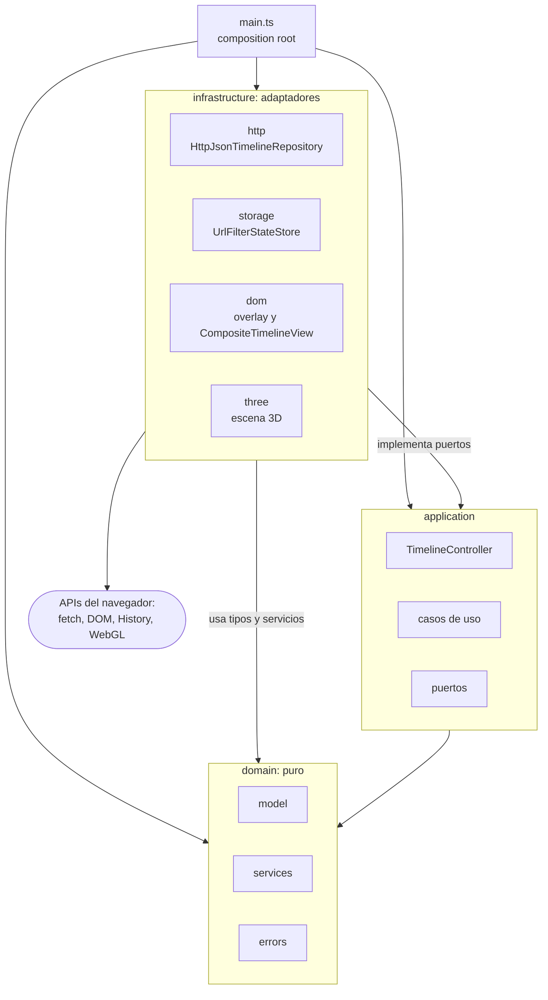

No existe ninguna flecha de `domain` hacia fuera ni de `application` hacia `infrastructure`.

### 5.4 (b) Diagrama de clases del dominio

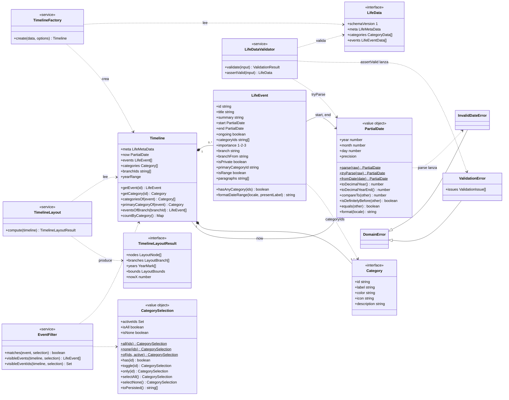

Notas:

- `LifeData` es la forma en crudo del JSON; `Timeline` es el agregado ya validado y normalizado (valores por defecto aplicados, eventos ordenados por fecha de inicio).
- `LifeEvent` y `CategorySelection` son inmutables: cada cambio de filtro devuelve una selección nueva.
- `TimelineLayoutResult` es geometría pura (`{x, y, z}`), sin tipos de three.js.

### 5.5 (c) Puertos y adaptadores

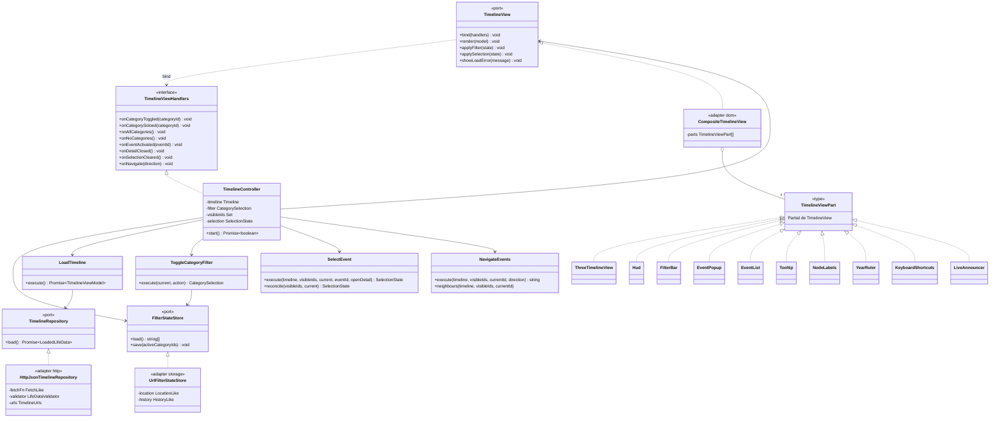

Notas:

- La comunicación es de ida y vuelta por interfaces: el controlador llama a la vista por el puerto `TimelineView`, y la vista devuelve las intenciones del usuario por `TimelineViewHandlers`, que implementa el propio controlador.
- `CompositeTimelineView` reparte cada llamada entre las piezas. Añadir o quitar una no afecta a las demás.
- `LoadTimeline` recibe además `TimelineFactory` y `TimelineLayout` (servicios de dominio), y el controlador recibe `EventFilter`.
- `HttpJsonTimelineRepository` recibe el validador por constructor porque «no valida → usar el ejemplo» es una decisión de carga.
- `ViewControls` (botones `+`, `−`, `◇`) no es una pieza de la vista: actúa directamente sobre la interfaz `CameraControls` de la escena.

### 5.6 (d) Componentes de la escena three

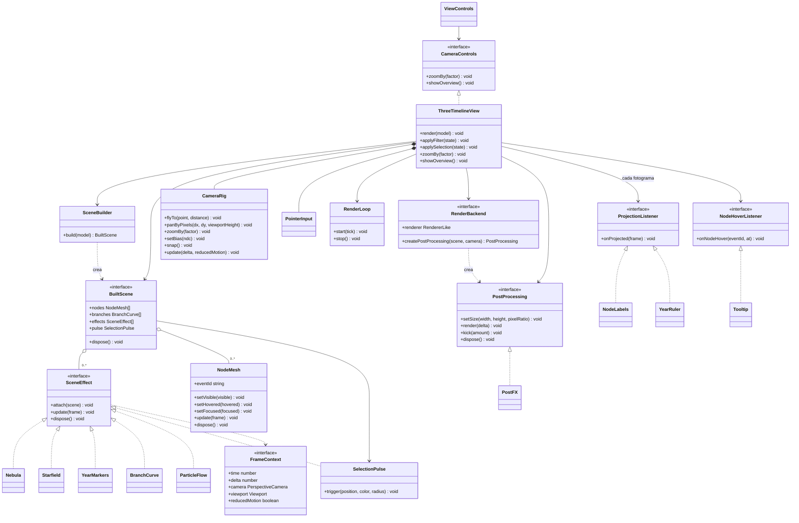

Qué hace cada efecto:

| Efecto | Qué dibuja |
| --- | --- |
| `Nebula` | Fondo procedural de nebulosa |
| `Starfield` | Tres capas de puntos: estrellas lejanas, estrellas medias y polvo cercano con deriva |
| `YearMarkers` | Meridianos verticales de cada año |
| `BranchCurve` | El tronco, cada rama y los tramos de duración de los eventos con fecha de fin |
| `ParticleFlow` | Motas de energía que recorren las ramas hacia el futuro, en un único `Points` |
| `SelectionPulse` | Anillo que se expande al seleccionar un nodo |

Cada fotograma, `ThreeTimelineView.frame` hace siempre lo mismo: actualiza la cámara, llama a `update(frame)` en todos los efectos y nodos, proyecta nodos y años a coordenadas de pantalla, resuelve el hover, avisa a los `ProjectionListener` y renderiza con el postprocesado (bloom). `NodeMesh` no es un `SceneEffect` porque además recibe estado de la aplicación (visible, enfocado, bajo el puntero), pero se actualiza con el mismo `FrameContext`.

Los rótulos de los nodos y la regla de años son elementos DOM colocados con esa proyección, no objetos 3D: así la tipografía queda nítida y fuera del bloom.

### 5.7 (e) Secuencia de arranque y carga de datos

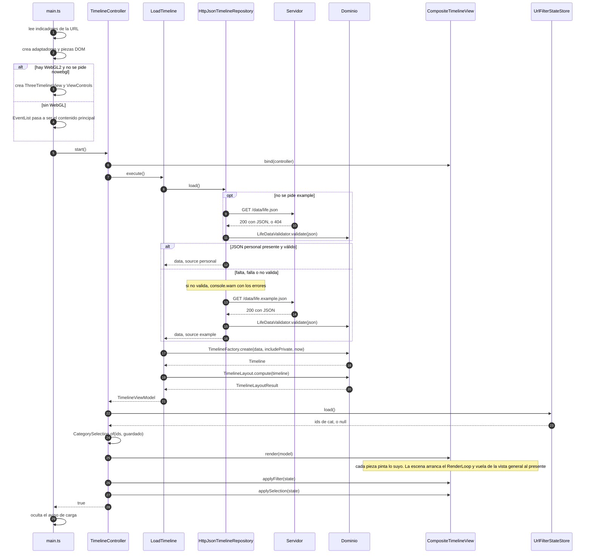

Si tampoco se puede cargar el ejemplo, el repositorio lanza `DataLoadError`, el controlador llama a `view.showLoadError(mensaje)` y `start()` devuelve `false`.

### 5.8 (f) Clic en un nodo: pop-up y vuelo de cámara

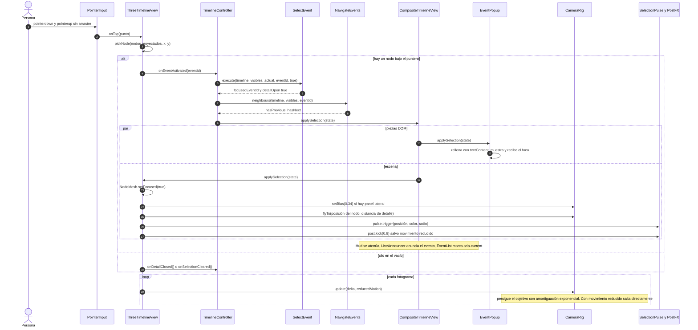

`SelectEvent` solo acepta eventos que existen y son visibles con el filtro actual; en otro caso la selección no cambia.

### 5.9 (g) Filtro por categoría

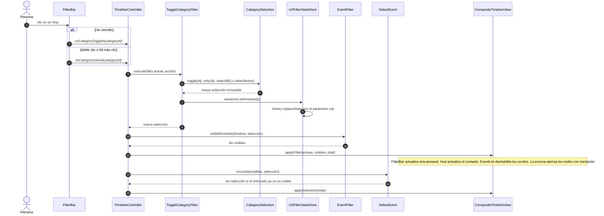

`toPersisted()` devuelve `null` cuando están todas activas, y entonces el parámetro `cat` se elimina de la URL.

### 5.10 (h) Comunicación cliente-servidor

No hay API ni backend: nginx sirve ficheros estáticos y el navegador hace todo el trabajo. Las únicas peticiones son el documento, los assets y uno o dos JSON.

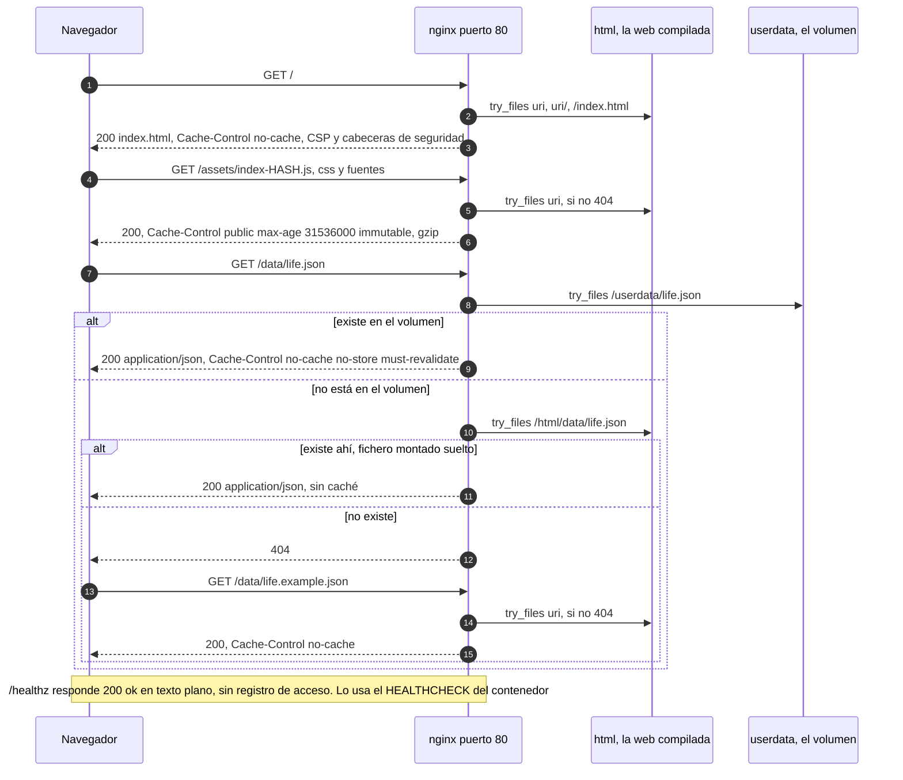

Rutas de `nginx/default.conf`:

| Ruta | Resolución | `Cache-Control` |
| --- | --- | --- |
| `= /healthz` | `return 200 "ok"` | — |
| `= /data/life.json` | `try_files /userdata/life.json /html/data/life.json =404` con raíz `/usr/share/nginx` | `no-cache, no-store, must-revalidate` |
| `/data/` | `try_files $uri =404` (aquí cae `life.example.json`) | `no-cache` |
| `/assets/` | `try_files $uri =404` (ficheros con hash en el nombre) | `public, max-age=31536000, immutable` |
| `/` | `try_files $uri $uri/ /index.html` | `no-cache` |

Además: gzip para texto, CSS, JS, JSON y SVG; `server_tokens off`.

Cabeceras de seguridad (`nginx/security-headers.conf`, incluidas en **cada** `location` porque en nginx un `add_header` dentro de un `location` anula los heredados):

| Cabecera | Valor |
| --- | --- |
| `Content-Security-Policy` | `default-src 'self'; script-src 'self'; style-src 'self'; img-src 'self' data: https:; font-src 'self'; connect-src 'self'; worker-src 'self' blob:; object-src 'none'; base-uri 'self'; form-action 'none'; frame-ancestors 'none'` |
| `X-Content-Type-Options` | `nosniff` |
| `X-Frame-Options` | `DENY` |
| `Referrer-Policy` | `strict-origin-when-cross-origin` |
| `Permissions-Policy` | `camera=(), microphone=(), geolocation=(), payment=(), usb=()` |
| `Cross-Origin-Opener-Policy` | `same-origin` |

El cliente pide los JSON con `cache: 'no-cache'` y `Accept: application/json`.

### 5.11 (i) Despliegue con Docker

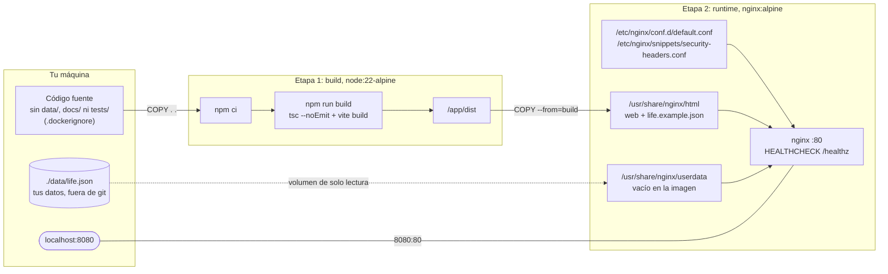

- La imagen final solo contiene nginx, su configuración y `dist/`. Ni Node, ni `node_modules`, ni el código fuente.
- `data/` está en `.dockerignore`: tus datos no entran ni siquiera en la etapa de build.
- `docker-compose.yml` define un servicio `web` (contenedor `alter-timeline`, imagen `alter-timeline-portfolio:local`, `restart: unless-stopped`).
- Si prefieres montar el fichero suelto, nginx también lo busca en `/usr/share/nginx/html/data/life.json`, pero el fichero debe existir antes de arrancar (si no, Docker crea un directorio con ese nombre).

### 5.12 (j) Flujo git e integración continua

Modelo de ramas: `main` (estable) ← `develop` (integración) ← `feature/*` (trabajo). A `main` solo se llega con la integración continua en verde.

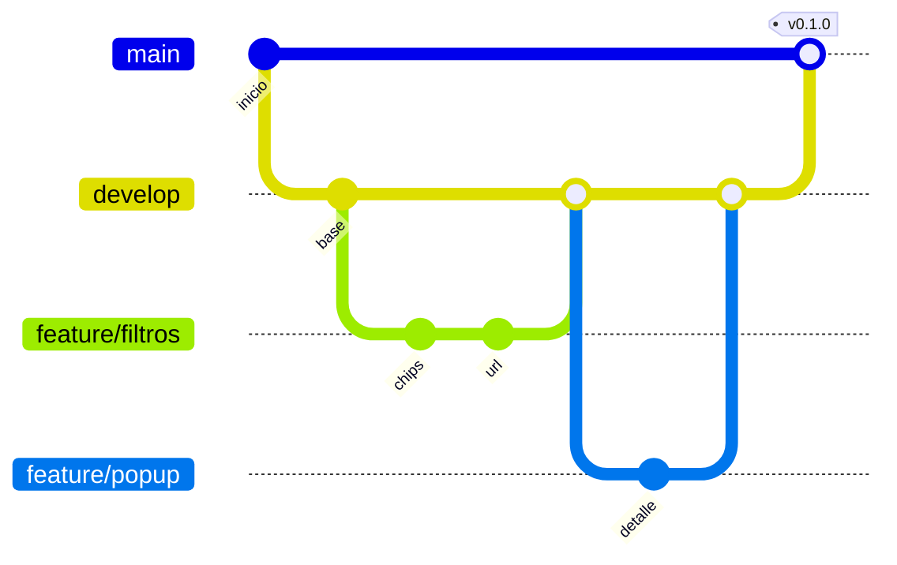

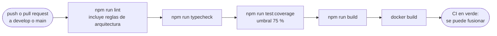

> [!NOTE]
> Este es el flujo definido en `docs/CONTRACT.md` (`.github/workflows/ci.yml`). En el momento de escribir esta documentación el fichero del workflow todavía no estaba en el repositorio; consulta [`docs/QA_REPORT.md`](docs/QA_REPORT.md) para el estado real. Los nombres de rama y la etiqueta del primer diagrama son ilustrativos.

---

## 6. Cómo extender

### 6.1 Añadir una categoría (solo datos)

No hay que tocar código. Añade una entrada a `categories` en tu `life.json` y úsala en los eventos:

```json
{ "id": "voluntariado", "label": "Voluntariado", "color": "#F2C14E", "icon": "✚", "description": "Trabajo no remunerado" }
```

El chip de filtro, el color de los nodos, la etiqueta del pop-up y el contador salen solos. Comprueba con `npm run validate:data`.

### 6.2 Añadir un efecto visual

1. Crea una clase en `src/infrastructure/three/` que implemente `SceneEffect`:

   ```ts
   import type { Scene } from 'three';
   import type { SceneEffect } from './SceneEffect';
   import type { FrameContext } from './types';

   export class Aurora implements SceneEffect {
     attach(scene: Scene): void { /* añade tus objetos a la escena */ }
     update(frame: FrameContext): void { /* anima con frame.time y frame.delta */ }
     dispose(): void { /* libera geometrías, materiales y texturas */ }
   }
   ```

2. Regístrala en la lista `effects` de `SceneBuilder.build()`. Es el único punto que hay que editar: `ThreeTimelineView` recorre esa lista y no necesita cambios.
3. Respeta `frame.reducedMotion` (los efectos existentes congelan el tiempo o reducen la velocidad) y, si generas partículas, escala la cantidad con `particleBudget`.
4. No uses canvas 2D para las texturas si quieres que se pueda probar en jsdom: las existentes son `DataTexture` procedurales (`textures.ts`).

### 6.3 Añadir otro origen de datos

Implementa el puerto `TimelineRepository` en `src/infrastructure/` y devuelve un `LifeData` ya validado:

```ts
import type { LoadedLifeData, TimelineRepository } from '../../application/ports';
import type { LifeDataValidator } from '../../domain/services';

export class LocalStorageTimelineRepository implements TimelineRepository {
  constructor(private readonly storage: Storage, private readonly validator: LifeDataValidator) {}

  async load(): Promise<LoadedLifeData> {
    const raw = JSON.parse(this.storage.getItem('life') ?? 'null');
    return { data: this.validator.assertValid(raw), source: 'personal' };
  }
}
```

Después sustituye el repositorio en `src/main.ts`. Ni el dominio, ni los casos de uso, ni la vista cambian. Si el origen puede fallar, puedes componerlo con `HttpJsonTimelineRepository` como respaldo.

Para cambiar solo las URL no hace falta un adaptador nuevo: el tercer parámetro del constructor de `HttpJsonTimelineRepository` es `{ primary, fallback }`.

### 6.4 Añadir una pieza de interfaz

Crea una clase que implemente los métodos de `TimelineView` que necesite (`TimelineViewPart = Partial<TimelineView>`) y añádela a la lista `parts` de `main.ts`. Si necesita seguir a la escena, implementa además `ProjectionListener`.

### 6.5 Internacionalización futura

Hoy la interfaz está solo en español. Lo que ya existe:

- `meta.locale` formatea las fechas (`Intl.DateTimeFormat`) y fija el atributo `lang` de la página.
- La mayoría de los textos de interfaz están centralizados en `src/infrastructure/dom/strings.ts` (`STRINGS`).

Lo que haría falta para un segundo idioma:

1. Convertir `STRINGS` en un diccionario por idioma elegido a partir de `meta.locale` e inyectarlo en las piezas DOM desde `main.ts`.
2. Mover a ese diccionario los textos que aún están escritos en el sitio: «Cuándo», «Dónde» y «Con» en `EventPopup`, «hoy» en `YearRuler`, y los de `index.html` (enlace de salto, botón «Índice», etiqueta de los controles, `<noscript>`).
3. Los mensajes del validador y de los errores de dominio también están en español; viven en el dominio y tendrían que devolver códigos en lugar de frases.
4. El contenido (títulos, descripciones) es un único idioma por fichero: para dos idiomas harían falta dos `life.json` o ampliar el esquema.

---

## 7. Calidad

### 7.1 Scripts npm

| Script | Qué hace |
| --- | --- |
| `npm run dev` | Servidor de desarrollo de Vite |
| `npm run build` | `tsc --noEmit` y `vite build` → `dist/` |
| `npm run preview` | Sirve `dist/` en el puerto 4173 |
| `npm run test` | Vitest, una pasada, entorno jsdom |
| `npm run test:coverage` | Lo mismo con cobertura v8 y umbrales |
| `npm run lint` | ESLint con typescript-eslint y las reglas de arquitectura |
| `npm run typecheck` | `tsc --noEmit` (TypeScript en modo estricto) |
| `npm run validate:data` | Valida un JSON de datos (ver [3.4](#34-validar-npm-run-validatedata)) |

La cadena completa que debe pasar antes de fusionar:

```bash
npm run lint && npm run typecheck && npm run test:coverage && npm run build
```

### 7.2 Tests y cobertura

- Vitest busca `tests/**/*.test.ts` y `src/**/*.test.ts`.
- Cobertura con v8 sobre `src/**/*.ts`. Solo se excluyen el composition root (`src/main.ts`) y los ficheros que únicamente declaran tipos (puertos, `LifeData.ts`, `Category.ts`, `SceneEffect.ts`, `types.ts`).
- **Umbral global del 75 %** en líneas, funciones, ramas y sentencias: por debajo, `npm run test:coverage` falla.
- Informes: texto en consola, HTML en `coverage/` y `lcov`.

Las cifras reales de cobertura y el resultado de cada comprobación están en [`docs/QA_REPORT.md`](docs/QA_REPORT.md). Este README no las repite para no quedarse desfasado.

El diseño facilita las pruebas sin GPU: `CameraRig` solo necesita una cámara, `RenderLoop` recibe el planificador y la fuente de visibilidad, `ThreeTimelineView` recibe un `RenderBackend` que puede ser un doble, y las texturas son procedurales. Lo único que exige WebGL real es `webgl.ts` y `PostFX.ts`.

### 7.3 Lint con reglas de arquitectura

Además de las reglas recomendadas de ESLint y typescript-eslint:

| Regla | Ámbito | Efecto |
| --- | --- | --- |
| `no-restricted-imports` | `src/domain` | No puede importar `three`, `infrastructure` ni `application` |
| `no-restricted-imports` | `src/application` | No puede importar `three` ni `infrastructure` |
| `no-restricted-globals` | `src/domain`, `src/application` | Prohibidos `window`, `document`, `fetch`, `localStorage`, `navigator`, `history`, `location` |
| `consistent-type-imports` | todo | Los tipos se importan con `import type` |
| `eqeqeq`, `no-unused-vars` | todo | Errores |
| `no-console` | todo | Aviso, salvo `console.warn` y `console.error` |

### 7.4 Comprobación visual: `scripts/ui-check.mjs`

Abre la web en Chrome sin interfaz (WebGL por software) y recorre el flujo completo: carga, escena, hover con tooltip, clic en nodo con pop-up y foco dentro, navegación, `Esc`, filtro (contador y URL), vista general, índice, móvil, modo sin WebGL y movimiento reducido con privados. Guarda capturas numeradas y termina con código 1 si falla alguna comprobación o hay errores de consola (salvo el 404 esperado de `/data/life.json`).

`puppeteer-core` no es dependencia del proyecto; se instala aparte:

```bash
npm i --prefix /tmp/ui-check puppeteer-core
npm run build && npm run preview &
NODE_PATH=/tmp/ui-check/node_modules node scripts/ui-check.mjs \
  --url http://localhost:4173 --out /tmp/ui-shots --example --settle 14000
```

| Opción | Por defecto | Uso |
| --- | --- | --- |
| `--url` | `http://localhost:4173` | Dirección de la web |
| `--out` | `./out/ui-check` | Carpeta de capturas |
| `--example` | desactivado | Añade `?example=1` |
| `--event <id>` | el nodo visible central | Nodo que se pulsa |
| `--category <id>` | la primera | Chip que se desactiva |
| `--settle <ms>` | `6000` | Espera tras cargar. Con renderizado por software hacen falta unos 14 s |
| `CHROME_BIN` (variable) | `/usr/bin/google-chrome` | Ruta del navegador |

<details>
<summary>Gancho de depuración <code>window.__timelineDebug</code> (solo con <code>?debug=1</code>)</summary>

```js
window.__timelineDebug.ready        // boolean: datos cargados
window.__timelineDebug.webgl        // boolean: escena 3D activa
window.__timelineDebug.nodes()      // [{ id, x, y, visible }] en píxeles CSS de la ventana
window.__timelineDebug.open('id')   // abre el pop-up de un evento
```

</details>

---

## 8. Seguridad y privacidad

### Contenido de los datos

- **Todo el contenido del JSON se pinta con `textContent`.** El único constructor de elementos es `el()` en `src/infrastructure/dom/dom.ts`; no hay `innerHTML` en el proyecto. Un `<script>` dentro de una descripción se ve como texto.
- **Enlaces solo http(s).** `isHttpUrl` exige una URL absoluta `http:` o `https:` con host. Se aplica tres veces: en el validador (rechaza el documento), en `TimelineFactory` (descarta el enlace) y en `safeLink()` (no crea el `<a>`). Un `javascript:` no llega nunca al DOM.
- Los enlaces se abren en pestaña nueva con `rel="noopener noreferrer"`.
- Las imágenes de `media` se cargan con `loading="lazy"` y `referrerpolicy="no-referrer"`; si fallan, la figura se retira.

### Cabeceras

- **CSP estricta**: scripts y estilos solo del propio origen, sin `unsafe-inline` ni `unsafe-eval`. Los estilos dinámicos (colores de categoría, posiciones de rótulos) se aplican por CSSOM (`element.style`), que la CSP permite; no hay atributos `style` en el HTML.
- `connect-src 'self'`: la web no puede enviar datos a terceros.
- Fuentes autoalojadas (`@fontsource`) con `font-src 'self'`: ninguna llamada a servidores externos. `assetsInlineLimit: 0` evita que el build incruste recursos como `data:`.
- `img-src` admite `https:` únicamente para las imágenes de los eventos.
- `frame-ancestors 'none'` y `X-Frame-Options: DENY`: la web no se puede incrustar en otra página.
- Tabla completa en [5.10](#510-h-comunicación-cliente-servidor).

> [!NOTE]
> Estas cabeceras las pone nginx. Con `npm run dev` y `npm run preview` no se aplican.

### Datos personales

- `data/life.json` está fuera del repositorio (`.gitignore`) y fuera de la imagen (`.dockerignore`): solo existe en tu máquina y en el volumen montado.
- La imagen publicada contiene únicamente los datos ficticios de ejemplo.
- `/data/life.json` se sirve sin caché (`no-store`).
- **Todo lo que haya en el `life.json` desplegado es público**, incluidos los eventos `private` (ver [3.8](#38-eventos-privados-y-private1)). No pongas en él nada que no quieras publicar.
- La web no usa cookies, almacenamiento local ni analítica. El único estado que guarda es el filtro, en la propia URL.

---

## 9. Accesibilidad y rendimiento

### Accesibilidad

| Aspecto | Cómo se resuelve |
| --- | --- |
| Alternativa a la escena 3D | Índice de eventos en DOM (lista ordenada de botones) con el mismo contenido y el mismo pop-up |
| Enlace de salto | «Saltar al índice de eventos», primer elemento enfocable |
| Teclado | Toda la navegación tiene atajo (ver [4.1](#41-navegación)). Los atajos no interfieren con `Enter` y `Espacio` sobre botones y enlaces |
| Pop-up | Diálogo **no modal**: `role="dialog"` y `aria-labelledby`, sin `aria-modal`, porque es un panel lateral y la escena, los filtros y el índice siguen operables. Al abrirse recibe el foco; `Tab` sale de él por el orden natural; al cerrarse devuelve el foco al elemento anterior (salvo que el usuario ya lo haya llevado a otro control) |
| Lector de pantalla | Región `aria-live` que anuncia título, fechas y resumen del evento enfocado; el contador de eventos también es `aria-live` |
| Filtros | Botones con `aria-pressed`, agrupados con `role="group"` y etiqueta |
| Escena | `role="application"`, enfocable, con una etiqueta que explica los atajos y remite al índice |
| Decoración | Rótulos de nodo y regla de años son `aria-hidden`: su contenido ya está en el índice |
| Movimiento reducido | Con `prefers-reduced-motion: reduce` (o `?reduced-motion=1`): la cámara corta en lugar de volar, sin parallax, el tiempo de los efectos se congela, las partículas van al 12 % de velocidad y al 30 % de cantidad, no hay destello de bloom y las transiciones CSS se anulan |
| Sin WebGL2 | La lista pasa a ser el contenido principal, con un aviso; filtros y pop-up siguen funcionando |
| Sin JavaScript | Mensaje `<noscript>` |
| Móvil | Pop-up e índice a pantalla completa, chips en una fila deslizable, márgenes de zona segura |

### Rendimiento

| Medida | Detalle |
| --- | --- |
| `pixelRatio` limitado | Máximo 2, aunque la pantalla tenga más densidad |
| Pausa con la pestaña oculta | `RenderLoop` cancela el fotograma pendiente al ocultarse y acota el salto de tiempo al volver (0,1 s) |
| Partículas en un solo objeto | `ParticleFlow` es un único `Points`; el campo de estrellas, tres |
| Presupuesto de partículas | 100 % en escritorio, 60 % en pantallas de 720 px o menos, 30 % con movimiento reducido. Se decide al cargar la página |
| Texturas procedurales | Sin descargas de imágenes para la escena |
| Sin antialias del renderer | El bloom ya suaviza; se ahorra el coste del multisampling |
| Rótulos | Elementos DOM movidos con `transform`; su anchura se estima sin medir el DOM |
| Red | Assets con hash y caché inmutable de un año, gzip, fuentes autoalojadas, una o dos peticiones de datos |
| Liberación de recursos | Cada efecto y nodo tiene `dispose()`; al volver a pintar se libera la escena anterior |

El coste principal por fotograma son el bloom y la nebulosa procedural a pantalla completa. No hay mediciones en GPU real (ver la sección siguiente).

---

## 10. Limitaciones conocidas y hoja de ruta

Tomadas de `docs/DEV_NOTES.md` y del propio código. Para el estado de las comprobaciones, [`docs/QA_REPORT.md`](docs/QA_REPORT.md).

### Limitaciones

| Área | Limitación |
| --- | --- |
| Privacidad | `visibility: "private"` se filtra en el navegador: no protege el contenido (ver [3.8](#38-eventos-privados-y-private1)) |
| Enlaces profundos | No se puede enlazar a un evento concreto (`?event=id` no existe). Solo el filtro vive en la URL |
| Idioma | Interfaz solo en español. `meta.locale` afecta al formato de fechas y al atributo `lang`, no a los textos |
| Muchas ramas | Con más de cuatro ramas simultáneas la escena crece en vertical y el encuadre por defecto se queda corto |
| Rótulos | Su anchura se estima por número de caracteres, no se mide. Un título largo se corta con «…» en el rótulo (no en el tooltip ni en el pop-up): para evitarlo, `shortTitle` |
| Rendimiento | Medido solo con renderizado por software (unos 4 fps a 1440×900). Sin datos en GPU real |
| Navegadores | Probado solo en Chrome sin interfaz. Sin pruebas en Firefox, Safari ni dispositivos táctiles reales |
| Docker | `docker build` sin ejecutar en el entorno de desarrollo (registros de imágenes bloqueados). La configuración de nginx sí se probó con un nginx local |
| CI | El workflow de GitHub Actions no estaba en el repositorio al escribir esta documentación |
| JSON Schema | No se valida contra el schema con ninguna librería; es documentación y ayuda para el editor |
| Presupuesto de partículas | Se calcula al cargar; cambiar la preferencia de movimiento o el tamaño de ventana no lo recalcula hasta recargar |

### Hoja de ruta

- [ ] Construir y probar la imagen Docker en CI o en una máquina con acceso al registro.
- [ ] Añadir el workflow de CI (`lint`, `typecheck`, `test:coverage`, `build`, `docker build`).
- [ ] Enlace profundo a eventos (`?event=id`), reutilizando el patrón de `UrlFilterStateStore`.
- [ ] Internacionalización de la interfaz (ver [6.5](#65-internacionalización-futura)).
- [ ] Medir el rendimiento en GPU real y, si hace falta, ofrecer un nivel de calidad reducido (bloom, nebulosa).
- [ ] Pruebas en Firefox, Safari y móviles reales.
- [ ] Revisar el encuadre por defecto con muchas ramas simultáneas.
- [ ] Medir la anchura real de los rótulos.

---

## 11. Licencia

Pendiente de definir por el autor.
